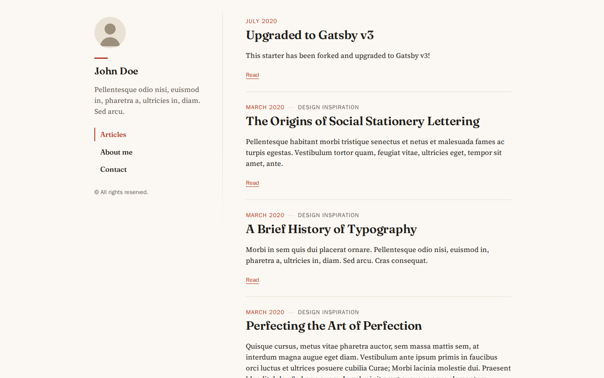
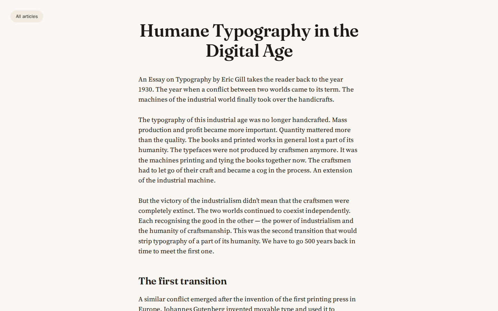
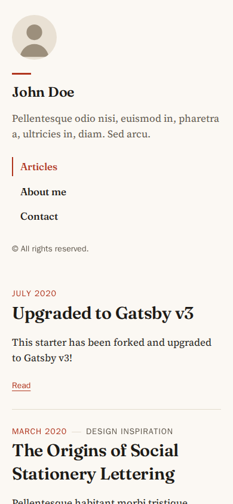
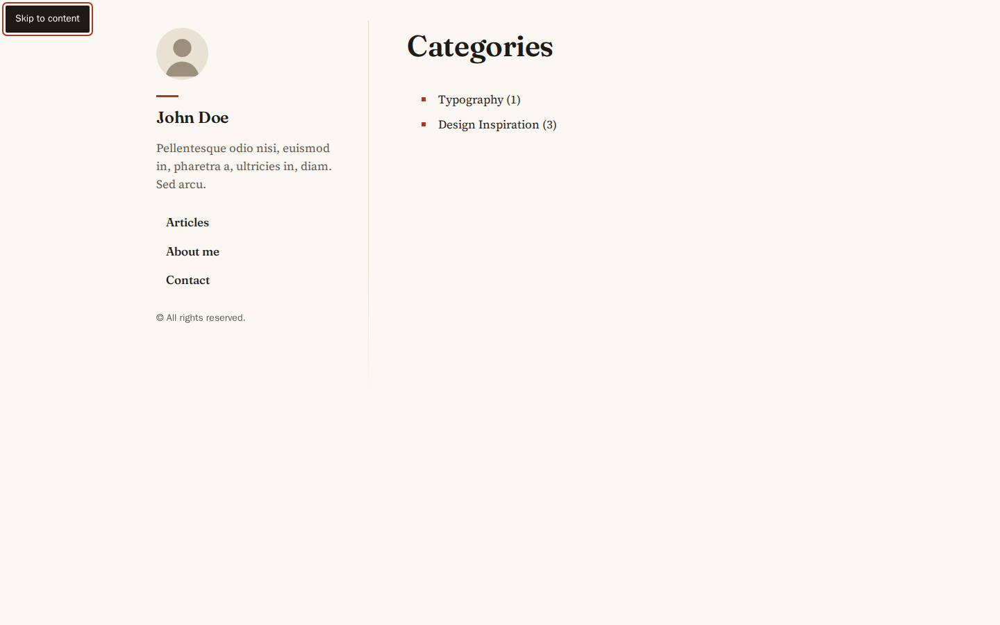
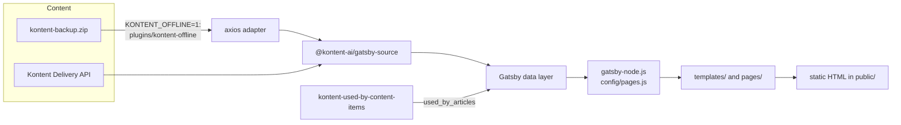

# Kontent Lumen

A small Gatsby blog that takes its content from the [Kontent.ai](https://kontent.ai/) headless CMS. It is my fork of Kentico's [gatsby-starter-kontent-lumen](https://github.com/Kentico/gatsby-starter-kontent-lumen), which I used in 2021 to learn Gatsby with Kontent before using the same stack on client sites. My part of the upstream work was the Gatsby v2 to v3 upgrade and incremental builds, and one of my pull requests was merged into the starter.

This version runs on Gatsby 5, React 18 and the `@kontent-ai` packages. It can also build entirely from the demo export that ships with the repository, so it can be run, tested and screenshotted without a Kontent account.

| Home                                                                                     | Article                                                                                  |
| ---------------------------------------------------------------------------------------- | ---------------------------------------------------------------------------------------- |
|  |  |

| Tag page                                                        | Phone                                                     | Keyboard focus                                                                |
| --------------------------------------------------------------- | --------------------------------------------------------- | ----------------------------------------------------------------------------- |
|  |  |  |

All screenshots show the demo content from `kontent-backup.zip`. The author photo in that export is replaced by a placeholder in offline builds.

## What the site does

- Lists articles newest first, with their category and a short description.
- Article pages render Kontent rich text (headings, lists, links, inline images).
- Tag and category pages, plus `/tags/` and `/categories/` indexes with article counts. The counts come from a small local plugin, `plugins/kontent-used-by-content-items`, which adds reverse links (tag → articles) to the GraphQL schema.
- Menu pages such as "About me" and "Contact" are Kontent `page` items linked from the navigation menu item.
- Author name, bio, avatar and profile links come from the `author` item. Profiles left as `#` are hidden.
- Kontent [Smart Link](https://github.com/kontent-ai/smart-link) data attributes are on every editable element, so the site works inside Web Spotlight (see [docs/WEB-SPOTLIGHT.md](docs/WEB-SPOTLIGHT.md)). Add `?preview-mode=true` to a URL to see the edit buttons.
- A sitemap is generated at build time.

## How it fits together



`gatsby-node.js` queries menu items, articles, tags and categories and hands the result to `config/pages.js`, which decides each page's URL, template and query context. The URL rules live in `src/utils/paths.js` and are shared with the components that link to those pages, so links and created pages cannot disagree. Duplicate slugs fail the build instead of one page silently replacing another.

### Offline mode

`KONTENT_OFFLINE=1` runs the real `@kontent-ai/gatsby-source` plugin, not a mock of it:

1. `config/kontent.js` points the plugin at a reserved host, `kontent-fixtures.invalid`, with a dummy project ID.
2. `plugins/kontent-offline` installs an axios adapter on the source plugin's own axios instance. It answers `/types` and `/items-feed` and rejects every other host, so an offline build cannot reach a real Kontent project.
3. The answers are built at startup from `kontent-backup.zip`. That file is the starter's public demo content, a Management API export. `backup-to-delivery.js` converts it to Delivery API JSON: it keeps published variants only, applies language fallback (cs-CZ to en-US), drops links to unpublished items and resolves rich-text images. A dependency-free reader in `read-zip.js` reads the archive, and the images are copied into `public/kontent-fixtures/`.

## Getting started

You need Node 22 (see `.nvmrc`) or Docker.

### Run it with the demo content

```sh
npm ci
npm run build:offline
npm run serve            # http://localhost:9000
```

`npm run develop:offline` starts the development server on http://localhost:8000 instead.

With Docker, the image builds the offline site and serves it with nginx as a non-root user:

```sh
docker build -t kontent-lumen .
docker run --rm -p 8080:8080 kontent-lumen    # http://localhost:8080
```

### Connect your own Kontent project

1. Create an empty project at [app.kontent.ai](https://app.kontent.ai) and restore `kontent-backup.zip` into it with Kontent's backup manager or template import. Then publish the imported items.
2. Create `.env` from the template and set your project ID (Project settings, then API keys):

   ```sh
   npm run prepare-environment   # copies .env.template to .env if .env does not exist
   ```

3. Run `npm run develop` or `npm run build`.

| Variable                     | Purpose                                                                                     |
| ---------------------------- | ------------------------------------------------------------------------------------------- |
| `KONTENT_PROJECT_ID`         | Required unless `KONTENT_OFFLINE=1`. The build stops with a clear message if it is missing. |
| `KONTENT_LANGUAGE_CODENAMES` | Comma-separated language codenames. Defaults to `en-US`.                                    |
| `KONTENT_PREVIEW_ENABLED`    | `true` to load unpublished content from the Preview Delivery API.                           |
| `KONTENT_PREVIEW_KEY`        | Preview API key; required when preview is enabled. Never commit it.                         |
| `KONTENT_OFFLINE`            | `1` builds from `kontent-backup.zip` and ignores the variables above.                       |

`.env` is git-ignored. None of these variables carry the `GATSBY_` prefix, so none of them reach the browser bundle. The project ID is the only value the page uses; Smart Link needs it, so it is passed in through `siteMetadata`.

### Preview deploy

Set `KONTENT_PREVIEW_ENABLED=true` and `KONTENT_PREVIEW_KEY` on a preview build, and set Kontent's preview URLs to point at it:

| Content type | Preview URL                                         |
| ------------ | --------------------------------------------------- |
| Article      | `https://preview.example.com/articles/{URLslug}/`   |
| Category     | `https://preview.example.com/categories/{URLslug}/` |
| Tag          | `https://preview.example.com/tags/{URLslug}/`       |
| Menu item    | `https://preview.example.com/{URLslug}/`            |
| Author, Menu | `https://preview.example.com/`                      |

`npm run develop` sets `ENABLE_GATSBY_REFRESH_ENDPOINT`, so the source plugin's webhook support can refresh a running preview server.

`netlify.toml` builds with `npm run build` on Node 22. Set the variables above in the Netlify UI instead of committing them.

## Scripts

| Command                               | What it does                                                                      |
| ------------------------------------- | --------------------------------------------------------------------------------- |
| `npm run develop` / `develop:offline` | Development server, live or from the demo export                                  |
| `npm run build` / `build:offline`     | Production build into `public/`                                                   |
| `npm run serve`                       | Serves the last build on port 9000                                                |
| `npm test`                            | Jest and Testing Library                                                          |
| `npm run lint`                        | ESLint (react, hooks, jsx-a11y) with zero warnings allowed, then a Prettier check |
| `npm run format`                      | Prettier write                                                                    |

## Tests

`npm test` runs 56 tests in 12 suites:

- `config/kontent.js` option rules (offline mode, missing ID, preview key handling).
- Page planning and URL helpers.
- The offline pipeline against the real `kontent-backup.zip`: ZIP reading, published-only output, language fallback, rich-text images, the portrait placeholder, and the adapter refusing non-fixture hosts.
- Components: article list items, the article page, sidebar, profile links, layout (skip link, Smart Link setup), tag and category pages and their empty states.

`gatsby` and `@kontent-ai/smart-link` are mocked under `__mocks__/`, following Gatsby's unit-testing guide.

To refresh the screenshots, build offline, serve `public/`, and run `scripts/capture-screenshots.mjs` with Playwright, for example inside `mcr.microsoft.com/playwright:v1.64.1-noble`:

```sh
node scripts/capture-screenshots.mjs http://localhost:9000 docs/screenshots
```

## Design notes

- The look keeps Lumen's sidebar-and-column layout and Lost grid. The demo content is about type and printing, so it uses ink on warm paper with a vermilion accent, Fraunces for headings and Source Serif 4 for text. Every text colour pair is at least 5.8:1.
- Accessibility: a skip link, `header`/`main` landmarks, a labelled main navigation, one `h1` per page, named icon links and visible focus outlines.
- Dates are formatted in UTC with `Intl`, so the server-rendered HTML matches the browser.
- Queries filter on `en-US`, as the starter always did. The Czech variants are sourced but not routed.

## Known limitations

- `@kontent-ai/gatsby-source` and `@kontent-ai/gatsby-components` are the final releases of Kontent's Gatsby integration, and npm marks both as "no longer supported". They work with Gatsby 5, but a longer-lived setup would source content with `@kontent-ai/delivery-sdk` directly.
- `npm audit` still reports advisories inside Gatsby 5's own build toolchain. None are critical, and they affect the build machine, not the static output.
- The live Kontent path has not been re-tested against a real project since this upgrade; the offline mode exercises the same source plugin with Delivery-shaped data.

## Credits and license

Based on [gatsby-starter-kontent-lumen](https://github.com/Kentico/gatsby-starter-kontent-lumen) by Kentico, which builds on [gatsby-starter-lumen](https://github.com/alxshelepenok/gatsby-starter-lumen) by Alexander Shelepenok and [gatsby-v2-starter-lumen](https://github.com/GatsbyCentral/gatsby-v2-starter-lumen). Typography in the original was inspired by [matejlatin/Gutenberg](https://github.com/matejlatin/Gutenberg).

MIT licensed. See [LICENSE](LICENSE) (Copyright (c) 2020 Kentico). [CONTRIBUTING.md](CONTRIBUTING.md) and [CODE_OF_CONDUCT.md](CODE_OF_CONDUCT.md) are the upstream project's documents.
